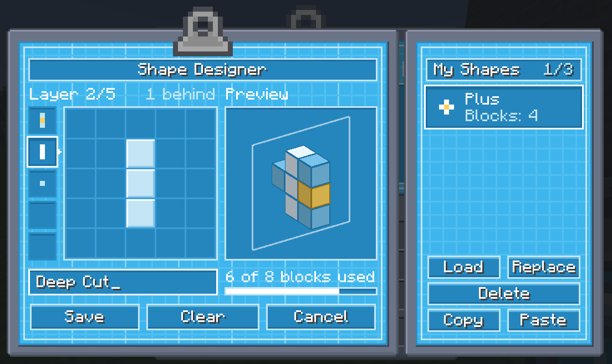

# Shape Designer

Draw an Ultimine shape of your own, name it and save it. It joins your shape list next to the built-in ones.

{ .ua-shot .ua-shot--gui loading=lazy }

## Opening it

Open the [Shape Selector](unlocking-ultimine.md#shape-selector) and click the pencil button. The designer pops up over it, and closing the designer brings you back.

## Drawing

The grid is what you see when you face the block you break, which is the gold cell in the middle.

- **Click** a cell to add or remove a block. **Drag** to draw a stroke: starting on an empty cell draws, starting on a block erases.
- **Layers** go behind the face, up to four deep. Pick one from the column on the left, or scroll the wheel over the grid. The layer in front shows through faintly, so you can line things up.
- **The preview** on the right shows the whole shape as blocks. Drag it to turn it. The outline marks the layer you are drawing on.
- The counter under the preview says how many blocks you have used of those a shape may have. The gold block doesn't count.

Type a name and press **Save**.

## Your shapes

The sheet on the right lists the shapes you keep. Click one to pick it, then:

| Button | Does |
|---|---|
| **Load** | Puts the shape on the grid, to change it or start from it. A double click does the same. |
| **Replace** | Saves the drawing and its name in place of that shape. It stays learned, and stays a favourite. |
| **Delete** | Removes it. The first click asks, the second deletes. |

You can keep a few shapes at a time (three by default). When the list is full, replace or delete one to make room.

## Sharing a shape

**Copy** puts the drawing on the clipboard as JSON, and **Paste** draws a shape that was copied. Send the text to a friend and they can paste it into their own designer.

The JSON is also a valid [data pack shape](packs/shapes.md), so a pack maker can save it as a file. A data pack shape pastes too, as long as it fits the designer's five by five by five.

## What it unlocks

A shape of your own is no way around the challenges. You learn it for the tools you can already Ultimine with: the ones you used a Shape Certificate for, or all of them with the Miner Certificate. Until then, Save tells you to learn a shape first.

Other players only get your shape the way they get any shape: with the Miner Certificate or a Mine-Go Juice.

## Favourite shapes

Every shape in the Shape Selector's list has a star. Mark the ones you use, and cycling shapes with the Ultimine key held only goes through the marked ones. With none marked, it goes through all of them.

## For servers and packs

In the [server settings](packs/configuration.md#progression): `progression.custom_shapes_per_player` is how many shapes a player may keep (`0` turns the designer off) and `progression.custom_shapes_max_blocks` is how many blocks one may have.

`/ultimine_addition my_shapes` lists your shapes and `my_shapes delete <number>` removes one, without opening the designer.
